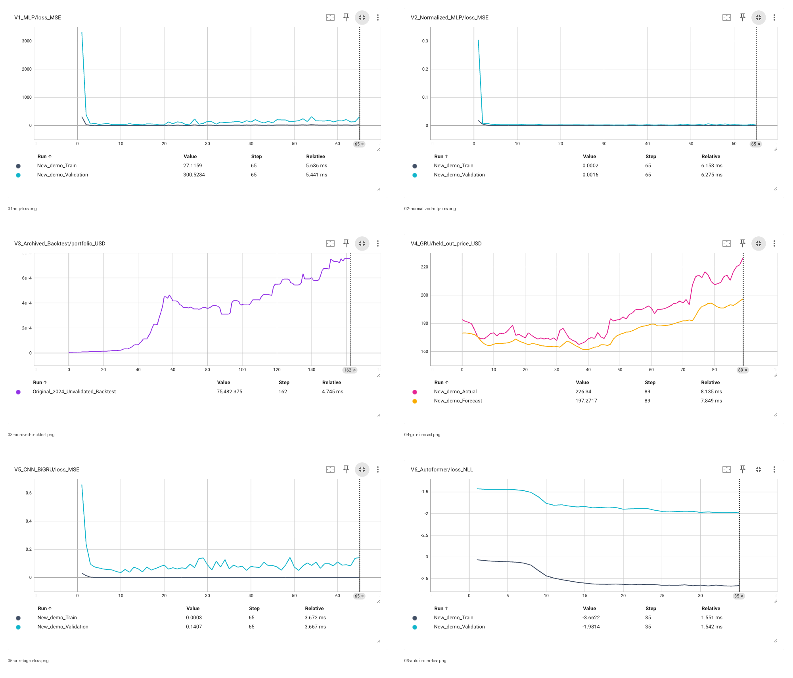

# Deep Learning Stock Forecasting

A portfolio archive of Zach Sharma's stock forecasting experiments: data preparation, GRU baselines, convolutional/bidirectional recurrent models, and transformer experiments in PyTorch.

**Outcome:** the project developed forecasting and data engineering skills; profitable trading or reliable predictive accuracy was not established. Suspicious early results led to the discovery of target leakage, as documented in the original project write-up.

**Slide visuals:** [native TensorBoard screenshots](visuals/tensorboard/) show the recorded curves with TensorBoard's own formatting. Fresh demonstration runs and historical evidence are labeled separately. Earlier Matplotlib figures and diagrams remain under [`visuals/`](visuals/) as alternatives.

## The six stages

The version numbers follow the supplied project write-up, *Algorithmic Trader*. The recovered archive contains experiments together in notebooks rather than six separately versioned releases.

| Stage | Project history | Code recovered for this collection |
| --- | --- | --- |
| V1 | MLP with ReLU and dropout | Exact stock MLP not located. `fundamentals/Perceptron&Linear.ipynb` contains related linear-layer and MLP learning exercises on classification data. |
| V2 | MLP with Min-Max normalization | Exact V2 stock MLP not located. The GRU notebook preserves later `MinMaxScaler` experiments. |
| V3 | Basic GRU with a 20-day lookback; target leakage discovered | Basic GRU class in `TrainAlgoTraderGRUNormalized.ipynb`, cell 87. Exact correspondence to the original V3 snapshot is unverified. |
| V4 | Revised data and normalization pipeline | Same notebook, cell 24: rolling input windows, separate future target, and sequential train/test split. This cell uses `index+21` after a 20-step window; it is not a verified next-day forecasting implementation. |
| V5 | CNN-BiGRU experiments | `TrainStrengthArchitecture.ipynb`, cell 38: three dilated convolution blocks and a bidirectional GRU. This recovered variant uses BatchNorm/ReLU; it differs from the MaxPool variant described in the project history. |
| V6 | Autoformer and custom transformer experiments | Autoformer configuration in `TrainStrengthArchitecture.ipynb`, cell 66; custom transformer scripts in `src/`. Development remained experimental. |

Notebook cell numbers are **zero-based archive indices**. They are not execution numbers.

## Browse the code

- [`notebooks/`](notebooks/) — original forecasting notebooks, with credentials removed and outputs cleared.
- [`src/`](src/) — archived custom architectures, trading integration, and utilities.
- [`fundamentals/`](fundamentals/) — learning exercises implementing neural network layers and recurrent networks. Some exercises follow external tutorials; retained source comments identify references where available.
- [`excerpts/`](excerpts/) — short source excerpts matching the screenshots. These are viewing excerpts, not independent runnable programs.
- [`screenshots/`](screenshots/) — nine readable code screenshots and two plots extracted from saved notebook output.
- [`SOURCE_MANIFEST.json`](SOURCE_MANIFEST.json) — original server paths, source hashes, and packaging changes.
- [`SLIDE_GUIDE.md`](SLIDE_GUIDE.md) — which images fit each section of the slide and the limits of each image.

## What the images establish

Code screenshots show code recovered from the archive, rendered for readability. They are not screenshots of a live training run. The two saved plots were extracted from original notebook output without rerunning the model. Their data split, execution history, and performance have not been independently validated. The notebook also contains incomplete experiments and errors.

The archival files were not executed during the initial packaging. A separate set of fresh demonstration runs was added on October 22, 2026; see [`visuals/`](visuals/) for the method and results. No new market data was fetched and no trading script was executed. Historical results should not be read as evidence of profitable or statistically significant predictions.

## Opening the archive

Open `.ipynb` files in GitHub, VS Code, or Jupyter to read them. To experiment locally, use an isolated Python environment and install the packages required by the specific notebook. Main dependencies include PyTorch, NumPy, pandas, scikit-learn, joblib, matplotlib, seaborn, pyarrow, transformers, GluonTS, datasets, and accelerate. Trading experiments additionally reference Lumibot, Alpaca, Ray, and yfinance.

The original environment was not recovered as a pinned dependency lockfile. Some scripts expect CUDA, older library APIs, local data files, and model checkpoints. This is an archival collection, not a tested end-to-end application. Large datasets, model weights, environments, and downloaded reference repositories are excluded.

Hardcoded Alpaca credentials in the included code were replaced with environment variable lookups. `.env.example` lists their names. Notebook outputs were cleared to avoid publishing stale output or private information. Original training logic was otherwise retained, including known limitations. The source server was left unchanged.

## Research context

The original write-up cites *Attention Is All You Need*, Informer, Autoformer, and Hugging Face's time-series forecasting examples. The Autoformer configuration uses the Hugging Face implementation; it is not an independently implemented Autoformer architecture. Separate custom transformer experiments are included under `src/`.

This portfolio compilation and its documentation were prepared with Codex from the recovered files. See the manifest for source provenance. No license is assigned to external code by this compilation.
